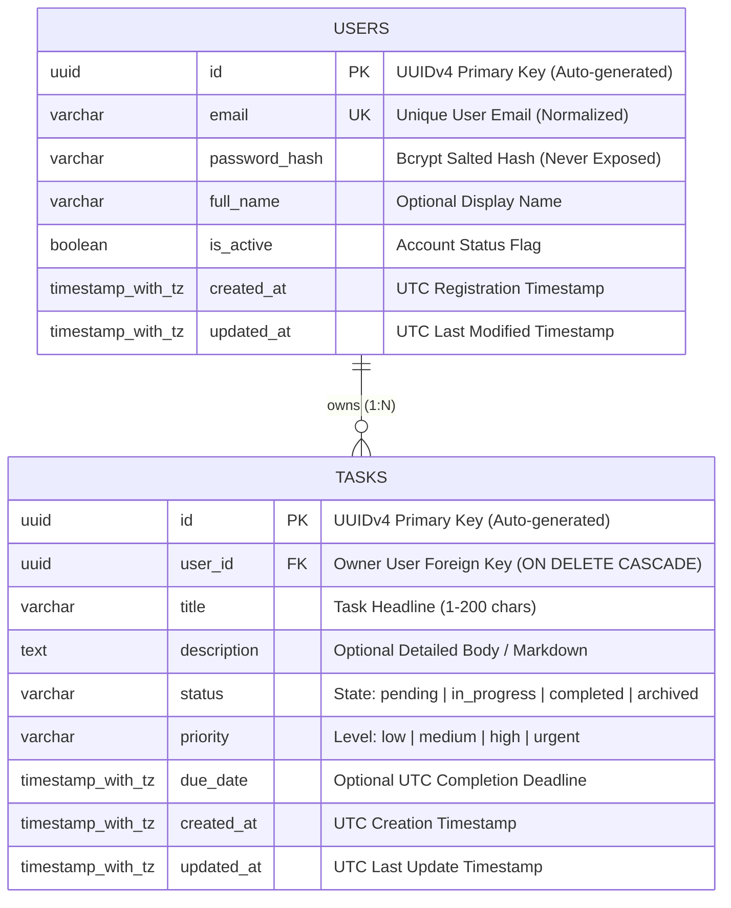

# Database Entity-Relationship & Schema Specification

**Project**: TaskFlow Orchestrator  
**Phase**: 1 — Requirements, Architecture & Design  
**Document Status**: Reviewed & Corrected Baseline  
**Lead Architect**: Senior Backend Architect (Rayhan AI Architecture)

---

## 1. Entity-Relationship Overview

TaskFlow Orchestrator Phase 1 specifies a normalized relational data model designed for high-concurrency multi-tenant operations. The core domain is built upon two foundational entities: **`User`** and **`Task`**.

### 1.1 Mermaid Entity-Relationship Diagram



---

## 2. Entity Specifications

### 2.1 `users` Table Specification

Stores user account identities, credential hashes, and operational status.

| Column Name | SQL Data Type | Nullable | Default / Generation | Description & Invariants |
| :--- | :--- | :--- | :--- | :--- |
| `id` | `UUID` | **NO** | `gen_random_uuid()` | Primary Key. UUIDv4 eliminates sequential ID enumeration risks. |
| `email` | `VARCHAR(255)` | **NO** | *None* | Unique, normalized (lowercase, trimmed) user email address. |
| `password_hash` | `VARCHAR(255)` | **NO** | *None* | Bcrypt salted hash (work factor 12). Strictly excluded from all serialization schemas. |
| `full_name` | `VARCHAR(255)` | **YES** | `NULL` | Optional human-readable display name. |
| `is_active` | `BOOLEAN` | **NO** | `TRUE` | Soft-deactivation flag; inactive users are blocked at auth dependency layer. |
| `created_at` | `TIMESTAMP WITH TIME ZONE` | **NO** | `CURRENT_TIMESTAMP` | Timezone-aware UTC timestamp of user account registration. |
| `updated_at` | `TIMESTAMP WITH TIME ZONE` | **NO** | `CURRENT_TIMESTAMP` | Timezone-aware UTC timestamp of last profile mutation. |

#### Constraints & Indexes (`users`)
- `PRIMARY KEY (id)`: Creates unique B-Tree index automatically.
- `UNIQUE INDEX ix_users_email ON users (email)`: Enforces uniqueness and accelerates O(1) credential lookups during authentication.

---

### 2.2 `tasks` Table Specification

Stores user-created operational tasks, lifecycle states, and deadlines.

| Column Name | SQL Data Type | Nullable | Default / Generation | Description & Invariants |
| :--- | :--- | :--- | :--- | :--- |
| `id` | `UUID` | **NO** | `gen_random_uuid()` | Primary Key. UUIDv4 eliminates sequential task enumeration risks. |
| `user_id` | `UUID` | **NO** | *None* | Foreign Key references `users(id)` with `ON DELETE CASCADE`. |
| `title` | `VARCHAR(200)` | **NO** | *None* | Non-empty concise task title (min length 1, max length 200). |
| `description` | `TEXT` | **YES** | `NULL` | Optional task details or markdown notes (max length 5000). |
| `status` | `VARCHAR(50)` | **NO** | `'pending'` | Controlled lifecycle enum: `pending`, `in_progress`, `completed`, `archived`. |
| `priority` | `VARCHAR(50)` | **NO** | `'medium'` | Controlled priority enum: `low`, `medium`, `high`, `urgent`. |
| `due_date` | `TIMESTAMP WITH TIME ZONE` | **YES** | `NULL` | Optional completion deadline stored in timezone-aware UTC. |
| `created_at` | `TIMESTAMP WITH TIME ZONE` | **NO** | `CURRENT_TIMESTAMP` | Timezone-aware UTC timestamp of task creation. |
| `updated_at` | `TIMESTAMP WITH TIME ZONE` | **NO** | `CURRENT_TIMESTAMP` | Timezone-aware UTC timestamp of last task update. |

#### Constraints & Indexes (`tasks`)
- `PRIMARY KEY (id)`: Creates unique B-Tree index automatically.
- `FOREIGN KEY (user_id) REFERENCES users(id) ON DELETE CASCADE`: Enforces referential integrity.
- `INDEX ix_tasks_user_id ON tasks (user_id)`: Foreign key index. Accelerates `ON DELETE CASCADE` checks and multi-tenant user joins.
- `INDEX ix_tasks_user_id_status ON tasks (user_id, status)`: Composite index. Accelerates status-filtered queries (`WHERE user_id = :uid AND status = :status`).
- `INDEX ix_tasks_user_id_created_at ON tasks (user_id, created_at DESC)`: Composite index. Accelerates paginated task lists (`WHERE user_id = :uid ORDER BY created_at DESC LIMIT :lim OFFSET :off`).
- `INDEX ix_tasks_user_id_title ON tasks (user_id, title)`: Composite index. Accelerates tenant-scoped title search and prefix queries.

---

## 3. Index Justification & Redundancy Review

### 3.1 Removal of Redundant Primary Key Indexes
In the initial draft, explicit DDL statements included:
- `CREATE INDEX ix_users_id ON users (id);` (REDUNDANT)
- `CREATE INDEX ix_tasks_id ON tasks (id);` (REDUNDANT)

**Correction**: Both statements are removed. In PostgreSQL and SQLite, declaring `PRIMARY KEY (id)` automatically creates a unique B-Tree index on `id`. Adding a secondary non-unique index on the exact same column:
1. Wastes disk space and shared buffer pool memory.
2. Increases write amplification and write latency on every `INSERT` and `DELETE`.
3. Creates index bloat without offering any query optimization benefit.

### 3.2 Query-to-Index Justification Matrix

| Index Name | Index Columns | Expected Query Pattern in Application | Justification & Expected Query Plan |
| :--- | :--- | :--- | :--- |
| `ix_users_email` | `(email)` UNIQUE | `SELECT * FROM users WHERE email = :email` | Fast single-row index lookup for `POST /api/v1/auth/login`. Enforces database-level uniqueness across registrations. |
| `ix_tasks_user_id` | `(user_id)` | `DELETE FROM users WHERE id = :id` (Cascading) | Prevents sequential scans on the child `tasks` table when deleting user records. Essential for PostgreSQL foreign key locking performance. |
| `ix_tasks_user_id_status` | `(user_id, status)` | `SELECT * FROM tasks WHERE user_id = :uid AND status = :st` | Enables index-only or index bitmap scans restricted to the user's partition, filtering immediately on the lifecycle state. |
| `ix_tasks_user_id_created_at` | `(user_id, created_at DESC)` | `SELECT * FROM tasks WHERE user_id = :uid ORDER BY created_at DESC LIMIT :limit OFFSET :offset` | Satisfies both the tenant boundary filter and the ordering clause directly from the index, avoiding an in-memory `Sort` node. |
| `ix_tasks_user_id_title` | `(user_id, title)` | `SELECT * FROM tasks WHERE user_id = :uid AND title LIKE :prefix` | Optimizes tenant-scoped title searches. Replaces an unscoped single-column `title` index to preserve tenant partition locality. |

---

## 4. UUID Generation Strategy & Migration Behavior

### 4.1 Dual-Tier UUID Generation
UUID generation is implemented with a clear separation between the application tier and the database engine tier:

1. **Application Tier Generation (Client-Side Default)**:
   - Defined in SQLAlchemy 2.x declarative models via `mapped_column(UUID(as_uuid=True), default=uuid.uuid4)`.
   - **Benefit**: UUIDs are generated in application memory *before* emitting the SQL `INSERT`. This allows the application to construct complex parent-child relationship graphs, correlation IDs, and audit logs without waiting for a database roundtrip.
2. **Database Tier Server Default (`gen_random_uuid()`)**:
   - Defined in PostgreSQL DDL via `server_default=sa.text('gen_random_uuid()')`.
   - **Benefit**: Direct SQL executions (Alembic data seeding, batch ingestion scripts, or administrative repairs) automatically receive cryptographically secure UUIDv4 identifiers without application intervention.
   - **PostgreSQL Version Note**: `gen_random_uuid()` is built into core PostgreSQL (version 13+) and does not require enabling external extensions such as `uuid-ossp` or `pgcrypto`.

---

## 5. Formal Alembic Migration DDL (Target Schema)

```sql
-- Alembic Revision: 001_initial_schema
-- Target Database: PostgreSQL 16+

-- 1. Create users table
CREATE TABLE users (
    id UUID NOT NULL DEFAULT gen_random_uuid(),
    email VARCHAR(255) NOT NULL,
    password_hash VARCHAR(255) NOT NULL,
    full_name VARCHAR(255),
    is_active BOOLEAN DEFAULT TRUE NOT NULL,
    created_at TIMESTAMP WITH TIME ZONE DEFAULT CURRENT_TIMESTAMP NOT NULL,
    updated_at TIMESTAMP WITH TIME ZONE DEFAULT CURRENT_TIMESTAMP NOT NULL,
    CONSTRAINT pk_users PRIMARY KEY (id)
);

CREATE UNIQUE INDEX ix_users_email ON users (email);

-- 2. Create tasks table
CREATE TABLE tasks (
    id UUID NOT NULL DEFAULT gen_random_uuid(),
    user_id UUID NOT NULL,
    title VARCHAR(200) NOT NULL,
    description TEXT,
    status VARCHAR(50) DEFAULT 'pending' NOT NULL,
    priority VARCHAR(50) DEFAULT 'medium' NOT NULL,
    due_date TIMESTAMP WITH TIME ZONE,
    created_at TIMESTAMP WITH TIME ZONE DEFAULT CURRENT_TIMESTAMP NOT NULL,
    updated_at TIMESTAMP WITH TIME ZONE DEFAULT CURRENT_TIMESTAMP NOT NULL,
    CONSTRAINT pk_tasks PRIMARY KEY (id),
    CONSTRAINT fk_tasks_user_id_users FOREIGN KEY (user_id) REFERENCES users (id) ON DELETE CASCADE
);

-- Purpose-driven secondary and composite indexes (Redundant PK indexes removed)
CREATE INDEX ix_tasks_user_id ON tasks (user_id);
CREATE INDEX ix_tasks_user_id_status ON tasks (user_id, status);
CREATE INDEX ix_tasks_user_id_created_at ON tasks (user_id, created_at DESC);
CREATE INDEX ix_tasks_user_id_title ON tasks (user_id, title);
```
