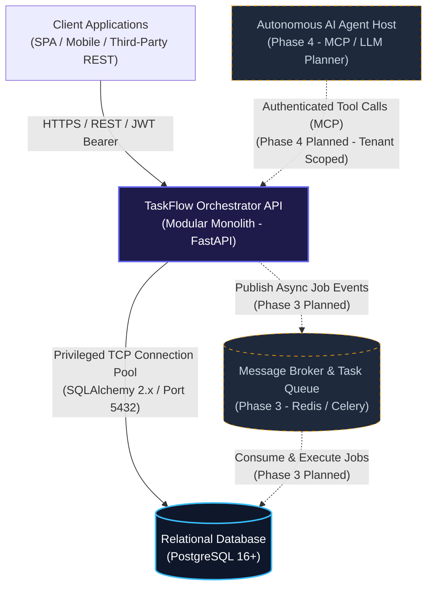
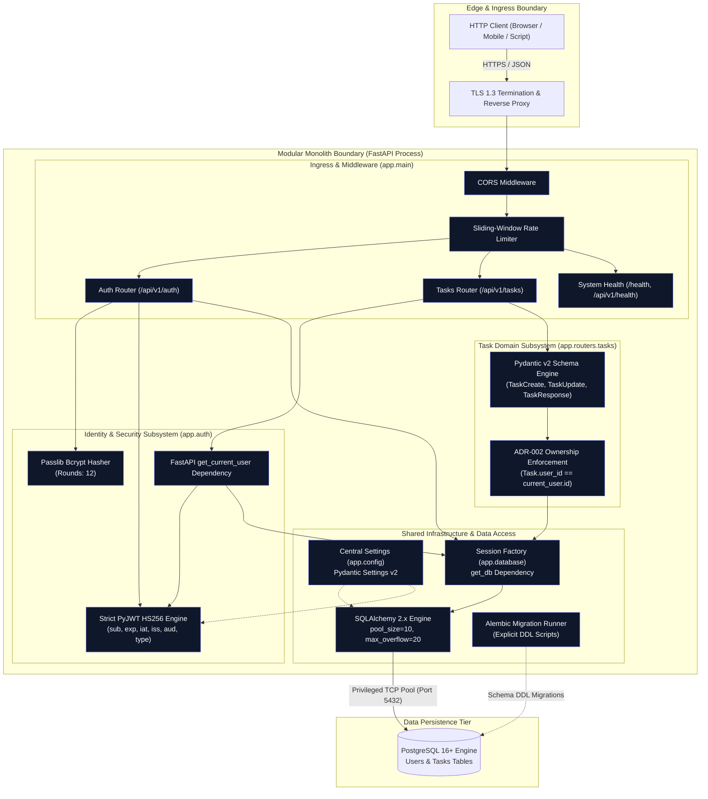
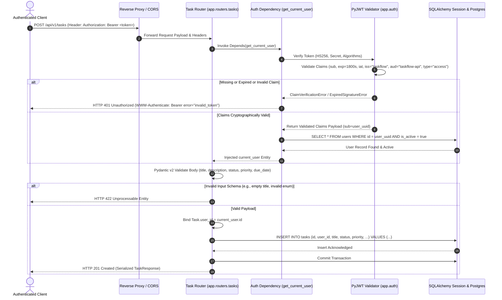
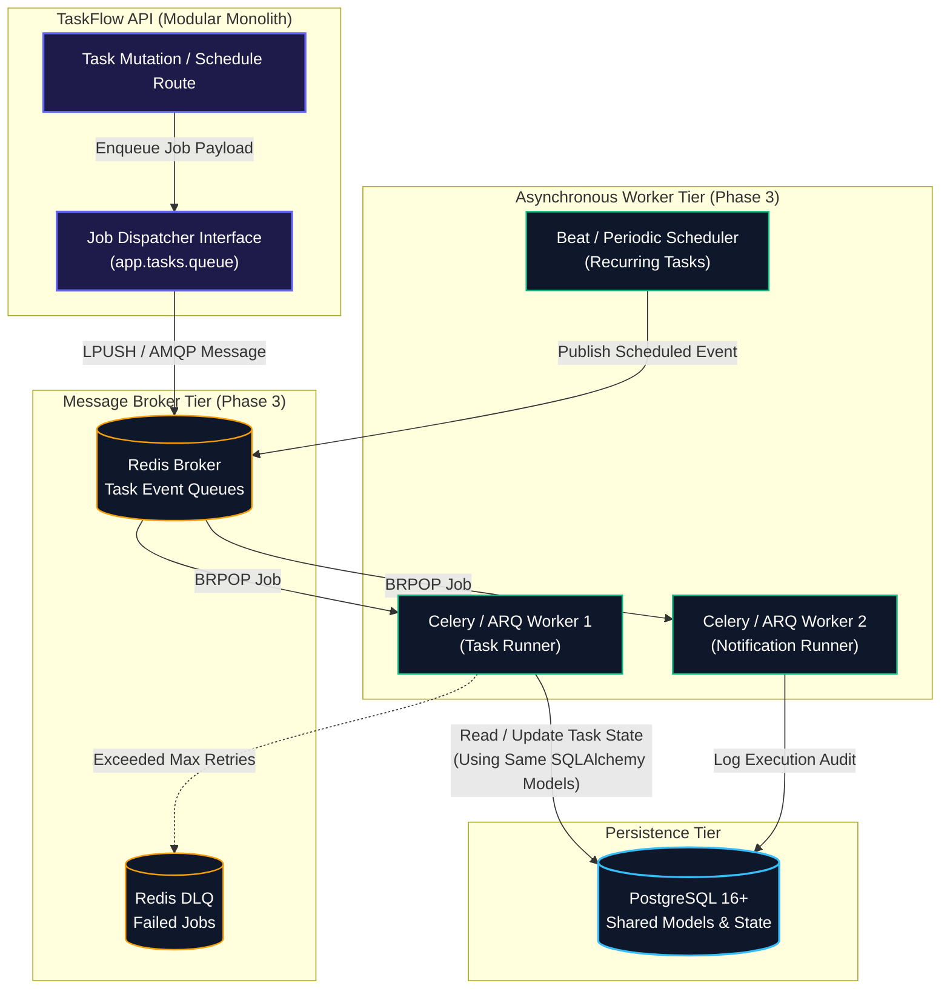

# System Architecture Specification

**Project**: TaskFlow Orchestrator  
**Phase**: 1 — Requirements, Architecture & Design  
**Document Status**: Reviewed & Corrected Baseline  
**Lead Architect**: Senior Backend Architect (Rayhan AI Architecture)

---

## 1. Executive Summary & System Context

TaskFlow Orchestrator is a multi-tenant task and workflow management platform engineered to deliver deterministic operational task tracking, strict multi-tenant boundary isolation, and forward-compatible extensibility for asynchronous job workers and autonomous AI planning agents.

### 1.1 System Context Diagram (C4 Level 1)



### 1.2 System Boundary & Lifecycle Scopes
- **Phase 1 (Current Baseline)**: Architecture, formal domain modeling, API contracts, security threat modeling, and test planning.
- **Phase 2 (Immediate Next)**: Core modular monolith implementation, FastAPI routes, SQLAlchemy 2.x declarative models, Alembic migrations, PyJWT authentication, and cross-tenant isolation test suites.
- **Phase 3 (Future Decoupled Extension)**: Asynchronous background worker queue (Redis / Celery or ARQ) for non-blocking task processing and cron scheduling.
- **Phase 4 (Future Decoupled Extension)**: Model Context Protocol (MCP) server and autonomous LLM planning agent integration.

---

## 2. Modular Monolith Component Architecture

TaskFlow Orchestrator is structured as an in-process **Modular Monolith** organized into distinct domain and infrastructure packages. Modules interact through strongly typed interfaces and FastAPI dependency injection, eliminating premature microservice operational overhead while maintaining strict internal boundaries.



---

## 3. End-to-End Request Lifecycle & Authorization Sequence

The following sequence details the full execution path for a protected task mutation request (`POST /api/v1/tasks`), demonstrating the exact validation checks for claims, active status, and ADR-002 ownership binding.



---

## 4. Future Queue / Worker Architecture (Phase 3 Planned)

Phase 3 introduces asynchronous background execution without breaking modular monolith boundaries. Synchronous HTTP endpoints never block on heavy operations; instead, jobs are dispatched to a Redis-backed message broker.



---

## 5. Future AI Planner & MCP Integration Architecture (Phase 4 Planned)

Phase 4 introduces autonomous task planning via the **Model Context Protocol (MCP)**. 

### Mandatory Multi-Tenant Security Guarantee:
AI agents and LLM planners **NEVER** receive direct database connection strings and **CANNOT** execute raw SQL queries. Every tool interaction routes through the authenticated application service layer, strictly binding tool execution to the verified tenant identity (`user_id`).

```mermaid
flowchart TD
    subgraph LLMClient["Autonomous AI Agent Host (Phase 4)"]
        PlannerAgent["LLM Task Planner\n(Gemini / Claude Agent)"]
    end

    subgraph MCPBoundary["MCP Service Interface Boundary"]
        MCPServer["Model Context Protocol Server\n(FastMCP / SSE Transport)"]
        TenantContextInjector["Tenant Security Context Injector\n(Binds API Key / Token -> tenant_id)"]
    end

    subgraph CoreApplication["TaskFlow Modular Monolith"]
        ToolRegistry["Registered Tool Handlers:\n- create_task_tool()\n- list_tasks_tool()\n- update_task_status_tool()"]
        AppServiceLayer["Application Service Layer\n(Enforces user_id == tenant_id)"]
        Persistence["SQLAlchemy 2.x Session Engine"]
    end

    subgraph Storage["PostgreSQL Database"]
        DB[(Tenant Scoped Records)]
    end

    PlannerAgent -->|"1. Request Tool Call (JSON-RPC)"| MCPServer
    MCPServer -->|"2. Extract Tenant Credentials"| TenantContextInjector
    TenantContextInjector -->|"3. Injected Authorized Context"| ToolRegistry
    ToolRegistry -->|"4. Execute Service with Bound tenant_id"| AppServiceLayer
    AppServiceLayer -->|"5. Scoped Query: WHERE user_id = tenant_id"| Persistence
    Persistence -->|"6. Query Execution"| DB
    DB -->> Persistence: Tenant Data Only
    Persistence -->> AppServiceLayer: Entity Result
    AppServiceLayer -->> ToolRegistry: Sanitized DTO
    ToolRegistry -->> MCPServer: Formatted Tool Result
    MCPServer -->> PlannerAgent: LLM Context Feed

    classDef agent fill:#1e1b4b,stroke:#a855f7,stroke-width:2px,color:#ffffff;
    classDef mcp fill:#0f172a,stroke:#10b981,stroke-width:1.5px,color:#ffffff;
    classDef core fill:#0f172a,stroke:#6366f1,stroke-width:1.5px,color:#ffffff;
    classDef storage fill:#0f172a,stroke:#38bdf8,stroke-width:2px,color:#ffffff;

    class PlannerAgent agent;
    class MCPServer,TenantContextInjector mcp;
    class ToolRegistry,AppServiceLayer,Persistence core;
    class DB storage;
```

---

## 6. Technology Choices & Trade-Off Matrix

| Technology Component | Approved Selection | Evaluated Alternatives | Technical Rationale & Architectural Trade-Offs |
| :--- | :--- | :--- | :--- |
| **Language & Framework** | **Python 3.11+ with FastAPI** | Node.js (NestJS), Go (Gin/Echo), Django | Rapid iteration, first-class asynchronous support (`asyncio`), native integration with Pydantic v2 validation, automatic OpenAPI 3.1 documentation, and immediate alignment with Python's AI/MCP ecosystem for Phase 4. |
| **Persistence Engine** | **PostgreSQL 16+** | MongoDB, MySQL, SQLite | Strong relational ACID guarantees, native UUID storage, robust composite B-Tree indexes, JSONB support for future tool telemetry, and native `pgvector` capability for semantic embeddings in Phase 4. |
| **ORM & Persistence** | **SQLAlchemy 2.x** | Tortoise ORM, Peewee, Raw asyncpg | SQLAlchemy 2.0 provides fully typed `Mapped` declarations, mature thread-safe connection pooling, explicit transaction control, and seamless Alembic migration integration. |
| **Schema Evolution** | **Alembic** | Flyway, Liquibase, Django Migrations | Native integration with SQLAlchemy models; enforces deterministic, version-controlled DDL script execution. Runtime `create_all` is prohibited. |
| **Multi-Tenant Security** | **ADR-002: Backend Privileged + App-Level** | PostgreSQL / Supabase Row-Level Security (RLS) | High connection pool performance, zero session variable contamination in pooling proxies, 100% vendor portability across clouds, and sub-second in-memory SQLite unit/API test suites. |
| **Authentication Standard** | **PyJWT (HS256) + Passlib (Bcrypt)** | External OAuth Providers (Auth0, Clerk) | Self-contained, zero external runtime network dependencies, complete architectural control over token claims and cryptographic verification parameters. |
