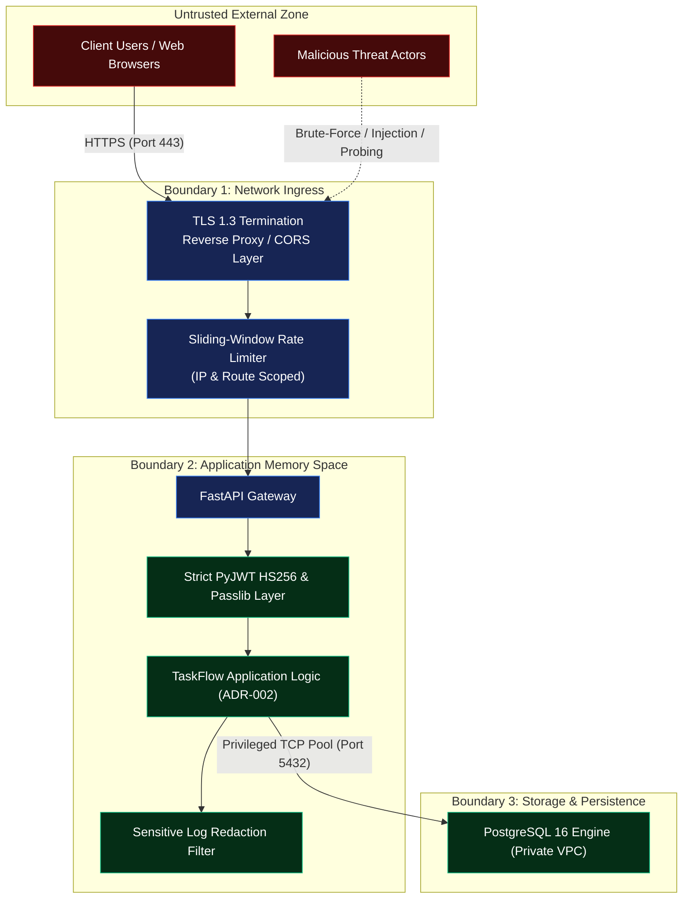

# Security Threat Model & Risk Assessment

**Project**: TaskFlow Orchestrator  
**Phase**: 1 — Requirements, Architecture & Design  
**Document Status**: Reviewed & Corrected Baseline  
**Methodology**: STRIDE + OWASP Top 10 API Security

---

## 1. System Assets & Trust Boundaries

### 1.1 Critical Assets
1. **User Identity & Credentials**: Email addresses, bcrypt-hashed passwords.
2. **Cryptographic Secrets**: JWT symmetric secret key (`JWT_SECRET_KEY`), database connection credentials (`DATABASE_URL`).
3. **Tenant Workflows & Tasks**: Task titles, detailed descriptions, status metadata, deadlines.
4. **Audit & Operational Logs**: System logs, database audit timestamps.

### 1.2 Trust Boundaries

---

## 2. STRIDE Threat Scenarios & Mitigations

### 2.1 Spoofing Identity
| Threat ID | Threat Description | Attack Vector | Mitigation in TaskFlow Orchestrator | Residual Risk |
| :--- | :--- | :--- | :--- | :--- |
| **S-01** | Counterfeit JWT | Generating tokens with algorithm `"none"` or wrong secret | PyJWT enforces explicit `algorithms=["HS256"]`. Requires 256-bit entropy `JWT_SECRET_KEY`. Validates all required claims (`sub`, `exp`, `iat`, `iss`, `aud`, `type`). | Server compromise / secret exposure. |
| **S-02** | Credential Stuffing / Brute-Force | Automated high-frequency password guessing on `/auth/login` | 1) Bcrypt hashing (work factor 12) enforces intentional CPU cost per attempt. 2) Rate-limiting: Max 5 attempts/minute per IP/account via sliding window. 3) Account lockout / progressive delays after consecutive failures. | Slow distributed attacks below rate thresholds (addressed by WAF anomaly scoring). |

### 2.2 Tampering with Data
| Threat ID | Threat Description | Attack Vector | Mitigation in TaskFlow Orchestrator | Residual Risk |
| :--- | :--- | :--- | :--- | :--- |
| **T-01** | Cross-tenant task modification | User B sends `PATCH /api/v1/tasks/{task_a_id}` | ADR-002: Service layer queries `Task.id == task_id AND Task.user_id == current_user.id`. Affects 0 rows if non-owner, raising HTTP 404. | Developer error in future endpoints (mitigated by automated CI isolation tests). |
| **T-02** | Token Payload Tampering | Altering `sub` UUID to impersonate another user | Cryptographic HS256 signature verification fails immediately on any modified bit in the header or payload. | Secret key exposure. |

### 2.3 Repudiation
| Threat ID | Threat Description | Attack Vector | Mitigation in TaskFlow Orchestrator | Residual Risk |
| :--- | :--- | :--- | :--- | :--- |
| **R-01** | Denying destructive task actions | Denying deletion of critical tasks | Timezone-aware UTC audit timestamps (`created_at`, `updated_at`) and structured application logging recording actor `user_id` and action. | Detailed immutable write-ahead event stream deferred to Phase 3. |

### 2.4 Information Disclosure & Account Enumeration
| Threat ID | Threat Description | Attack Vector | Mitigation in TaskFlow Orchestrator | Residual Risk |
| :--- | :--- | :--- | :--- | :--- |
| **I-01** | Password hash leakage in API responses | Calling `/auth/register` or `/auth/me` | Pydantic v2 `UserResponse` schema strictly omits `password_hash`. Field is never serialized across the network. | Negligible; verified by automated unit tests inspecting response keys. |
| **I-02** | Account Enumeration via Login Error Messages | Submitting emails to check whether they exist | Login returns uniform error message: `"Incorrect email or password"` for both non-existent emails and wrong passwords. | Slight timing delta in DB query vs bcrypt hash computation (mitigated by constant-time dummy verification). |
| **I-03** | Task Existence Enumeration | Attacker probes task UUIDs across accounts | Any non-owned task query returns HTTP 404 Not Found (indistinguishable from a non-existent task ID). | 128-bit UUIDv4 space makes brute-force guessing mathematically intractable ($2^{122}$ random bits). |
| **I-04** | Sensitive Information in Application Logs | Tokens, passwords, or PII dumped into server logs | Sensitive Log Redaction Filter strips `Authorization` headers, passwords, and tokens before emitting structured JSON logs. | Unhandled third-party library stack traces during fatal panics. |

### 2.5 Denial of Service (DoS)
| Threat ID | Threat Description | Attack Vector | Mitigation in TaskFlow Orchestrator | Residual Risk |
| :--- | :--- | :--- | :--- | :--- |
| **D-01** | Deep Pagination Memory Exhaustion | Requesting `GET /api/v1/tasks?limit=1000000` | FastAPI `Query(limit=20, ge=1, le=100)` enforces a strict ceiling of 100 items per request page. | High volume of valid queries from distributed botnets (requires upstream WAF). |
| **D-02** | Database Connection Pool Exhaustion | Flooding concurrent requests | SQLAlchemy connection pool (`pool_size=10, max_overflow=20, pool_pre_ping=True`) queues connections cleanly without exceeding Postgres limits. | Long-running queries blocking pool slots under extreme concurrency. |

### 2.6 Elevation of Privilege
| Threat ID | Threat Description | Attack Vector | Mitigation in TaskFlow Orchestrator | Residual Risk |
| :--- | :--- | :--- | :--- | :--- |
| **E-01** | Inactive User Access | Deactivated user using unexpired token | `get_current_user` queries `User.is_active.is_(True)` on every request before executing router logic. | Active token valid until revocation/check executes. |
| **E-02** | SQL Injection | Injecting SQL syntax into task titles or filters | 100% Parameterized queries mediated exclusively by SQLAlchemy 2.x ORM. Zero raw string concatenation. | None. |

---

## 3. Secret Management & Cryptographic Rotation Strategy

1. **Secret Storage**:
   - `JWT_SECRET_KEY` and `DATABASE_URL` are strictly injected via runtime environment variables and secret stores (AWS Secrets Manager, GCP Secret Manager, or HashiCorp Vault). Never committed to version control.
2. **Cryptographic Key Rotation Procedure**:
   - JWT Secret Rotation: The system architecture supports dual-key rotation during maintenance windows:
     - `JWT_SECRET_KEY_CURRENT`: Used for signing new tokens and verifying incoming tokens.
     - `JWT_SECRET_KEY_PREVIOUS`: Used as a fallback verification key during the 30-minute transition grace period.
   - Database Credential Rotation: Managed via cloud IAM credentials or PostgreSQL role rotation with graceful connection pool draining.

---

## 4. Residual Risks of Choosing Application-Level Authorization (No RLS)

Choosing ADR-002 (Application-Level Authorization) instead of Database Row-Level Security incurs specific architectural trade-offs:

| Residual Risk | Severity | Root Cause | Multi-Layer Defense Mitigations |
| :--- | :--- | :--- | :--- |
| **Developer Omission in Future Queries** | **High** | A future developer implements a new endpoint and writes `where(Task.id == task_id)` while omitting `where(Task.user_id == current_user.id)`. | 1) Mandatory CI/CD gate executing `SEC-ISO-*` isolation tests. 2) Base repository design enforcing `user_id` parameter on all queries. 3) AST code analysis rule failing PRs with unscoped tenant queries. |
| **Privileged Pool Blast Radius** | **Medium** | If the application process memory or backend container is compromised, the attacker has access to the privileged database pool. | 1) PostgreSQL bound strictly to private VPC subnet with zero public internet ingress. 2) Container runs as unprivileged user in read-only filesystem. 3) Application logs redacted of all database connection parameters. |
