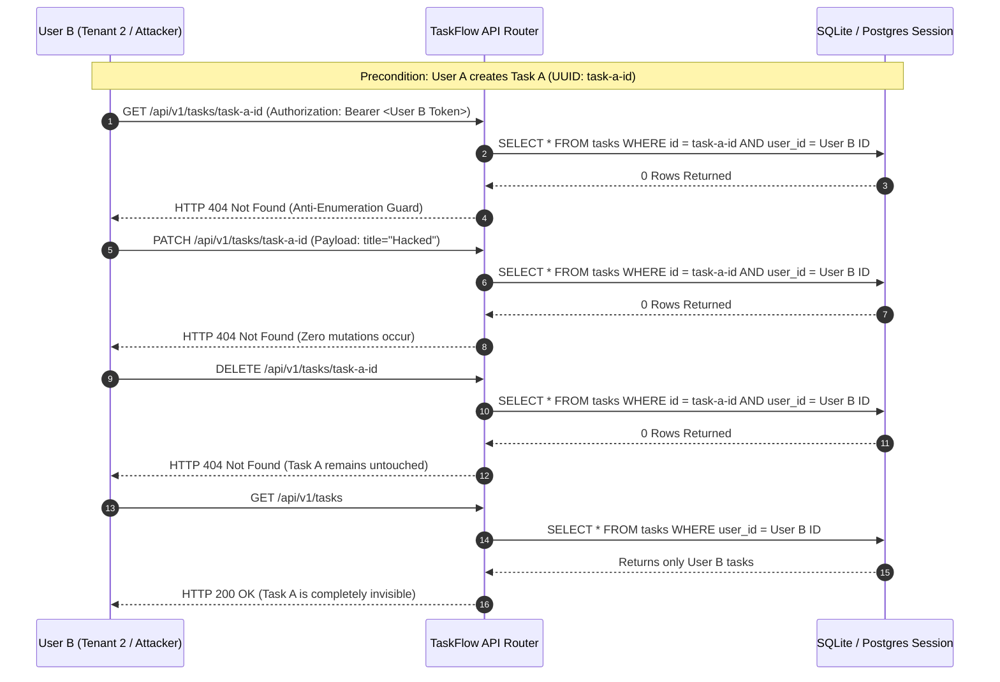

# Test Plan & Verification Strategy

**Project**: TaskFlow Orchestrator  
**Phase**: 1 — Requirements, Architecture & Design  
**Document Status**: Reviewed & Corrected Baseline  
**Execution Status**: **PLANNED SPECIFICATION (No Tests Executed in Phase 1)**  
**Frameworks**: Pytest 8.x + FastAPI TestClient + SQLite In-Memory + PostgreSQL Test Container

---

## 1. Dual-Environment Testing Philosophy

To balance developer iteration speed with real-world database fidelity, the TaskFlow Orchestrator test strategy establishes a **dual-environment execution model**:

```
[ Tier 4: Cross-Tenant Isolation Tests (Mandatory) ] ──► Fast In-Memory SQLite Engine
                         ▲
[ Tier 3: API Contract & HTTP Lifecycle (TestClient) ] ──► Fast In-Memory SQLite Engine
                         ▲
[ Tier 2: Real Database Migrations & Constraint Tests ] ──► Dedicated PostgreSQL 16+ Engine
                         ▲
[ Tier 1: Unit Validation & Cryptographic Primitives ] ──► Pure In-Memory Python / Pytest
```

### 1.1 Dual Environment Allocation
1. **In-Memory SQLite with StaticPool**:
   - Used for: Tier 1 (Unit), Tier 3 (API Contracts), and Tier 4 (Cross-Tenant Isolation).
   - Benefit: Sub-second test feedback loop (0.2s–0.5s for the entire suite) running in local virtual environments and CI PR validation without waiting for external services.
2. **Dedicated PostgreSQL 16+ Engine (CI Service / Testcontainers)**:
   - Used for: Tier 2 (Alembic Migrations, PostgreSQL-specific DDL, Constraints, and Timezones).
   - Rationale: SQLite does not validate PostgreSQL native `UUID` defaults (`gen_random_uuid()`), does not enforce composite index execution plans, and handles timezone conversions differently than PostgreSQL `TIMESTAMPTZ`.

---

## 2. Test Suite Specifications & Acceptance Criteria

*Governance Notice*: All test cases listed below represent **PLANNED TEST SPECIFICATIONS** for implementation and execution in Phase 2. No test execution or pass status is claimed in Phase 1.

### 2.1 Tier 1: Unit Validation & Cryptography Tests (Planned)

| Test Case ID | Target Module | Test Scenario & Inputs | Expected Outcome (Acceptance Criteria) | Environment |
| :--- | :--- | :--- | :--- | :--- |
| **PLN-UT-01** | `app.auth` | Password hashing using `get_password_hash()` | Returns valid Bcrypt string (starts with `$2b$12$`); hash is salted and non-deterministic across calls. | In-Memory |
| **PLN-UT-02** | `app.auth` | Password verification via `verify_password()` | Matching plaintext returns `True`; incorrect candidate returns `False`. | In-Memory |
| **PLN-UT-03** | `app.auth` | Token issuance via `create_access_token()` | Returns valid JWT with all 6 required claims (`sub`, `exp`, `iat`, `iss`, `aud`, `type="access"`). Expiry is exactly 30 min. | In-Memory |
| **PLN-UT-04** | `app.schemas` | Register payload with password < 8 chars | Pydantic v2 raises `ValidationError` mapped to HTTP 422. | In-Memory |
| **PLN-UT-05** | `app.schemas` | TaskCreate payload with empty title (`""`) | Pydantic v2 raises `ValidationError` mapped to HTTP 422. | In-Memory |
| **PLN-UT-06** | `app.schemas` | TaskUpdate with partial fields | Produces valid model; unset fields return `None` and are excluded via `model_dump(exclude_unset=True)`. | In-Memory |

---

### 2.2 Tier 2: Real PostgreSQL Integration & Migration Verification (Planned)

| Test Case ID | Target Subsystem | Test Scenario & Inputs | Expected Outcome (Acceptance Criteria) | Environment |
| :--- | :--- | :--- | :--- | :--- |
| **PLN-PG-01** | `alembic` | Run `alembic upgrade head` on clean Postgres | Successfully creates `users` and `tasks` tables with all FKs, unique constraints, and composite indexes. | **PostgreSQL 16+** |
| **PLN-PG-02** | `alembic` | Run `alembic downgrade base` on migrated Postgres | Drops all tables, indexes, and constraints cleanly without transaction deadlocks or orphaned objects. | **PostgreSQL 16+** |
| **PLN-PG-03** | `alembic` | Run `upgrade -> downgrade -> upgrade` cycle | Idempotent migration cycle completes with zero schema drift. | **PostgreSQL 16+** |
| **PLN-PG-04** | `app.models` | Native PostgreSQL UUID generation | Direct SQL `INSERT` without providing `id` generates valid UUIDv4 via `gen_random_uuid()`. | **PostgreSQL 16+** |
| **PLN-PG-05** | `app.models` | PostgreSQL Foreign Key Cascade on Delete | Deleting a user in PostgreSQL cascades automatically to remove all associated task rows (`ON DELETE CASCADE`). | **PostgreSQL 16+** |
| **PLN-PG-06** | `app.models` | Timezone-Aware UTC Timestamp Storage | Inserting UTC datetime preserves timezone precision in PostgreSQL `TIMESTAMPTZ` column. | **PostgreSQL 16+** |

---

### 2.3 Tier 3: API & Authentication End-to-End Tests (Planned)

| Test Case ID | Endpoint Route | Scenario & Request Data | Expected HTTP Status & Assertion | Environment |
| :--- | :--- | :--- | :--- | :--- |
| **PLN-API-01** | `POST /api/v1/auth/register` | Valid unique email and 8+ char password | `201 Created`. Response matches `UserResponse`. `password_hash` is **strictly absent**. | SQLite / TestClient |
| **PLN-API-02** | `POST /api/v1/auth/register` | Duplicate registration with existing email | `409 Conflict`. Detail states account already exists. | SQLite / TestClient |
| **PLN-API-03** | `POST /api/v1/auth/login` | Valid credentials via `application/json` | `200 OK`. Returns `access_token`, `token_type="bearer"`, `expires_in_seconds=1800`. | SQLite / TestClient |
| **PLN-API-04** | `POST /api/v1/auth/login` | Invalid password or non-existent email | `401 Unauthorized`. Generic message: `"Incorrect email or password"`. | SQLite / TestClient |
| **PLN-API-05** | `GET /api/v1/auth/me` | Valid Bearer JWT | `200 OK`. Returns requesting user profile. | SQLite / TestClient |
| **PLN-API-06** | `GET /api/v1/auth/me` | Expired JWT token (> 30 minutes) | `401 Unauthorized`. Detail explicitly states token expiration. | SQLite / TestClient |
| **PLN-API-07** | `GET /api/v1/auth/me` | Tampered token signature | `401 Unauthorized`. Cryptographic validation fails. | SQLite / TestClient |
| **PLN-API-08** | `GET /api/v1/auth/me` | Token missing required claim (e.g. no `aud`) | `401 Unauthorized`. Rejection of non-compliant claims. | SQLite / TestClient |

---

### 2.4 Tier 4: ADR-002 Cross-Tenant Isolation Tests (Planned - Mandatory)

These tests prove compliance with **ADR-002: Backend Privileged Connection with Application-Level Authorization**.



| Test Case ID | Method & Route | Scenario & Assertion | Environment |
| :--- | :--- | :--- | :--- |
| **PLN-ISO-01** | `GET /api/v1/tasks/{task_a_id}` | User B attempts to read User A's task. **Must return 404 Not Found**. | SQLite / TestClient |
| **PLN-ISO-02** | `PATCH /api/v1/tasks/{task_a_id}` | User B attempts to modify User A's task. **Must return 404 Not Found**. Task A remains unmodified. | SQLite / TestClient |
| **PLN-ISO-03** | `DELETE /api/v1/tasks/{task_a_id}` | User B attempts to delete User A's task. **Must return 404 Not Found**. Task A remains in database. | SQLite / TestClient |
| **PLN-ISO-04** | `GET /api/v1/tasks` | User B lists tasks. User A's tasks **must not appear**; count reflects strictly User B records. | SQLite / TestClient |

---

## 3. Test Execution Pipeline & Commands (For Phase 2 Implementation)

When implemented in Phase 2, the test pipeline will execute as follows:

```bash
# Fast Local & CI Unit/API/Isolation Test Suite (In-Memory SQLite)
pytest -v tests/test_auth.py tests/test_tasks.py

# PostgreSQL Integration & Migration Test Suite (Requires local or CI PostgreSQL service)
pytest -v tests/test_postgres_integration.py

# Complete Test Suite with Coverage
pytest --cov=app --cov-report=term-missing tests/
```

### Exit Criteria for Phase 2 Verification
1. 100% of planned test specifications must pass.
2. Zero cross-tenant data leaks across read, update, delete, or list operations.
3. Successful Alembic forward and backward migration cycle on PostgreSQL 16+.
4. Code coverage across `app/routers/tasks.py` and `app/auth.py` must exceed 95%.
